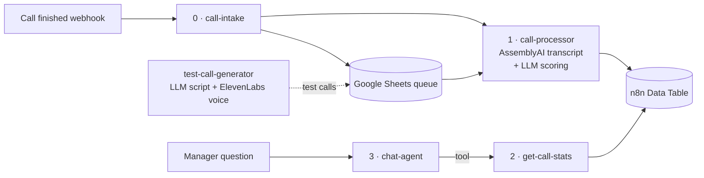

# AI Call Analytics

AI transcribes every customer call, scores it by mood and topic, and stores the result in an n8n Data Table. A manager can then ask for stats in plain words — "how many angry calls about delivery this week?" — and gets an answer from an AI agent.

> **Demo case.** This is a demo project for **Karline**, a fictional company. All calls, transcripts and customer data in this repo are test data generated by the `test-call-generator` workflow — no real customers or recordings are involved.

**Result:** about 28 seconds per call, 8/8 correct on the test set.

## How it works

1. **Intake** (`karline-0-call-intake`, 4 nodes) — a webhook fires when a call ends; real recordings over 5 s are added to a Google Sheets queue without duplicates.
2. **Processing** (`karline-1-call-processor`, 16 nodes) — runs every 2 minutes, takes one new call, gets the AssemblyAI transcript, and an LLM (via OpenRouter) classifies mood and topic. The result goes to the `call_evaluations` Data Table; the queue row is marked Done or Error.
3. **Stats tool** (`karline-2-get-call-stats`, 3 nodes) — a sub-workflow that filters calls by period and counts them by mood and topic.
4. **Chat agent** (`karline-3-chat-agent`, 5 nodes) — the manager asks in natural language; the agent calls the stats tool and answers in plain words.
5. **Test generator** (`karline-test-call-generator`, 9 nodes) — an LLM writes a fictional call, ElevenLabs voices it, the mp3 is saved to Google Drive and added to the queue.

## Stack
n8n (AI Agent, sub-workflows as tools, Data Tables) · AssemblyAI · OpenRouter (free `nvidia/nemotron-3-super-120b-a12b` model) · ElevenLabs · Google Sheets & Drive

## Setup
1. Import `workflows/*.json` into n8n.
2. Connect your AssemblyAI, OpenRouter and Google Sheets credentials; create a Google Sheet queue (`Calls`), a Drive folder for mp3 files and a Data Table `call_evaluations`.
3. Replace placeholders (`YOUR_GOOGLE_SHEET_ID`, `YOUR_GOOGLE_DRIVE_FOLDER_ID`, `YOUR_DATA_TABLE_ID`).
4. Run the test generator to check everything works.

---
Built by Anastasiia Ukrainska · [Portfolio](https://app.notion.com/p/Anastasiia-Ukrainska-AI-Automator-3c61a7c286c881c7b3f0e59620343c67)
